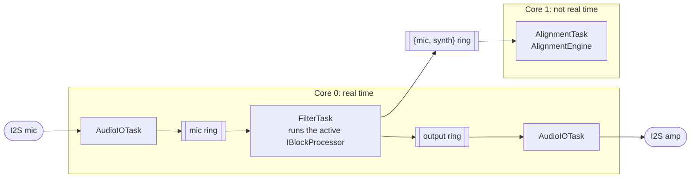

# Code map

What each header does and how audio flows between them. For the reasons
behind the design, read the [design doc](design.md); for what's left to
build, see the [roadmap (#138)](https://github.com/GageLawton/noise-cancellation/issues/138).

The firmware runs every task below: it calibrates the speaker-to-mic path,
cancels the hum, tracks its frequency, answers serial commands and prints
telemetry once a second. What's left is checking it on the bench, and the
multi-node pieces (M7), which are still marked **(planned)**.

## How audio flows

Two cores split the work (design doc
[section 5.4](design.md#54-task--concurrency-design-freertos)). Core 0 runs the
real-time audio path and must never wait; core 1 runs the slower analysis.
Every arrow between tasks is a lock-free ring buffer
([`spsc_ring_buffer.hpp`](../components/anc_hal/include/anc/spsc_ring_buffer.hpp)).

`AlignmentTask` takes each pair of {what the mic heard, what we played}, removes
our own speaker from the mic signal, tracks where each hum has drifted to, and
decides when the speaker-to-mic model is stale and needs recalibrating.
`TelemetryTask` prints the node's status once a second.

## Block processors

`FilterTask` doesn't know which milestone it is running. Every block it
reads the mic samples, hands them to whichever
[`IBlockProcessor`](../components/dsp_core/include/anc/block_processor.hpp) is
active, and sends what comes back to the speaker. Each milestone plugs in by
adding a processor: silence while the node starts up or is muted
(`SilenceProcessor`), a fixed test tone for M3 (`ToneProcessor`), the white-noise
probe for M4 calibration (`ProbeProcessor`), and the FxLMS canceller for M5
(`FxlmsProcessor`). Switching milestones means switching the active processor,
not rewriting the audio path.

## Headers by component

Every header lives in `components/<name>/include/anc/`.

### anc_hal

The only layer that touches ESP-IDF drivers.

| Header | What it does |
|---|---|
| [`audio_io.hpp`](../components/anc_hal/include/anc/audio_io.hpp) | `IAudioIo` interface: read a block of mic samples, write a block of speaker samples, as floats in [-1, 1]. |
| [`i2s_audio_io.hpp`](../components/anc_hal/include/anc/i2s_audio_io.hpp) | The real ESP32 driver: one full-duplex I2S port, amp on TX and mic on RX, sharing BCLK and WS. |
| [`i2s_settings.hpp`](../components/anc_hal/include/anc/i2s_settings.hpp) | Sample rate, pins and DMA size passed to the I2S driver. |
| [`pins.hpp`](../components/anc_hal/include/anc/pins.hpp) | The ESP32-S3 pin map for the mic, the amp and the future sync line. |
| [`sample_format.hpp`](../components/anc_hal/include/anc/sample_format.hpp) | Converts raw 24-bit mic samples to floats, and floats to 16-bit speaker samples. |
| [`spsc_ring_buffer.hpp`](../components/anc_hal/include/anc/spsc_ring_buffer.hpp) | Lock-free single-producer, single-consumer ring buffer that links the tasks. |

### dsp_core

Signal processing that runs in the real-time path. No ESP-IDF, so it is all
tested on a laptop.

| Header | What it does |
|---|---|
| [`block_processor.hpp`](../components/dsp_core/include/anc/block_processor.hpp) | `IBlockProcessor`: turns one block of mic samples into one block of speaker samples. |
| [`dc_blocker.hpp`](../components/dsp_core/include/anc/dc_blocker.hpp) | Removes a constant offset from the mic while keeping a 60 Hz hum. |
| [`decibels.hpp`](../components/dsp_core/include/anc/decibels.hpp) | Converts between amplitude and decibels. |
| [`decimator2x.hpp`](../components/dsp_core/include/anc/decimator2x.hpp) | Halves the sample rate (16 kHz to 8 kHz) with an anti-aliasing filter. |
| [`divergence_detector.hpp`](../components/dsp_core/include/anc/divergence_detector.hpp) | Spots a canceller going unstable from its residual power. |
| [`fir_filter.hpp`](../components/dsp_core/include/anc/fir_filter.hpp) | Fixed-size FIR filter, used to model the speaker-to-mic path. |
| [`fxlms_canceller.hpp`](../components/dsp_core/include/anc/fxlms_canceller.hpp) | Cancels one hum tone with FxLMS, using a sine and a cosine weight. |
| [`fxlms_processor.hpp`](../components/dsp_core/include/anc/fxlms_processor.hpp) | Runs an `FxlmsCanceller` as a block processor (M5). |
| [`gain_ramp.hpp`](../components/dsp_core/include/anc/gain_ramp.hpp) | Fades the output gain in or out so switching doesn't click. |
| [`goertzel.hpp`](../components/dsp_core/include/anc/goertzel.hpp) | Measures the amplitude of one frequency in a block of samples, such as the hum the tracker follows. |
| [`output_limiter.hpp`](../components/dsp_core/include/anc/output_limiter.hpp) | Clamps every speaker sample to the configured ceiling and reports clipping. |
| [`passthrough_processor.hpp`](../components/dsp_core/include/anc/passthrough_processor.hpp) | Copies the mic to the speaker at a fixed gain, as a quick bench check. |
| [`peak.hpp`](../components/dsp_core/include/anc/peak.hpp) | Largest absolute sample in a block, for spotting clipping or a too-loud signal. |
| [`ref_generator.hpp`](../components/dsp_core/include/anc/ref_generator.hpp) | Generates the sine and cosine reference at a given frequency. |
| [`rms.hpp`](../components/dsp_core/include/anc/rms.hpp) | Root mean square level of a block of samples. |
| [`running_power.hpp`](../components/dsp_core/include/anc/running_power.hpp) | Exponential running average of signal power. |
| [`silence_processor.hpp`](../components/dsp_core/include/anc/silence_processor.hpp) | Block processor that outputs silence. |
| [`tone_processor.hpp`](../components/dsp_core/include/anc/tone_processor.hpp) | Block processor that plays a steady test tone (M3). |
| [`upsampler2x.hpp`](../components/dsp_core/include/anc/upsampler2x.hpp) | Doubles the sample rate (8 kHz to 16 kHz), the partner to the decimator. |

### calibration

Measures the speaker-to-mic path (M4).

| Header | What it does |
|---|---|
| [`calibration_recorder.hpp`](../components/calibration/include/anc/calibration_recorder.hpp) | Fixed-size store for the {probe played, mic heard} pairs of one run. |
| [`calibration_scheduler.hpp`](../components/calibration/include/anc/calibration_scheduler.hpp) | Decides when to recalibrate: on drift or after the backstop interval, never inside the cooldown. |
| [`ir_analysis.hpp`](../components/calibration/include/anc/ir_analysis.hpp) | Finds the biggest tap of an impulse response and converts its index to a delay in ms. |
| [`ir_estimator.hpp`](../components/calibration/include/anc/ir_estimator.hpp) | Estimates the impulse response from the probe and the recording. |
| [`probe_generator.hpp`](../components/calibration/include/anc/probe_generator.hpp) | Repeatable white noise for the calibration probe. |
| [`probe_processor.hpp`](../components/calibration/include/anc/probe_processor.hpp) | Block processor that plays the probe and records what the mic hears. |

### alignment

The slower analysis that runs in `AlignmentTask` (M6).

| Header | What it does |
|---|---|
| [`alignment_engine.hpp`](../components/alignment/include/anc/alignment_engine.hpp) | Ties the pieces below together for each {mic, synth} pair. |
| [`drift_detector.hpp`](../components/alignment/include/anc/drift_detector.hpp) | Spots a stale speaker-to-mic model and asks for recalibration. |
| [`pll.hpp`](../components/alignment/include/anc/pll.hpp) | Phase-locked loop that follows a hum's frequency as it drifts. |
| [`reconstructor.hpp`](../components/alignment/include/anc/reconstructor.hpp) | Estimates the room noise by subtracting our own speaker from the mic. |
| [`rolling_correlation.hpp`](../components/alignment/include/anc/rolling_correlation.hpp) | Running normalized correlation between two signals. |

### config

Settings stored in `/cfg/node.json`; see [config.md](config.md).

| Header | What it does |
|---|---|
| [`command_parser.hpp`](../components/config/include/anc/command_parser.hpp) | Parses serial commands like `get`, `set`, `save` and `recal`. |
| [`config_keys.hpp`](../components/config/include/anc/config_keys.hpp) | Maps `section.key` names to `NodeConfig` fields for the serial commands. |
| [`config_store.hpp`](../components/config/include/anc/config_store.hpp) | Loads and saves `NodeConfig` as JSON on the flash filesystem (device only). |
| [`node_config.hpp`](../components/config/include/anc/node_config.hpp) | Every runtime setting, its defaults and its validation. |

### node_runtime

Runs the node.

| Header | What it does |
|---|---|
| [`node_runtime.hpp`](../components/node_runtime/include/anc/node_runtime.hpp) | Owns the node's lifecycle: config, state machine and starting the tasks. |
| [`node_state.hpp`](../components/node_runtime/include/anc/node_state.hpp) | The states (Boot, InitHal, CalibrateSecondaryPath, Run, Fault and so on) and their names. |
| [`node_status.hpp`](../components/node_runtime/include/anc/node_status.hpp) | Status snapshot for telemetry, and a store that lets one task write it while others read. |

### transport

Talking between nodes (M7, planned).

| Header | What it does |
|---|---|
| [`crc8.hpp`](../components/transport/include/anc/crc8.hpp) | One-byte CRC-8 checksum, so a node can throw away a corrupted message. |
| [`sync_frame.hpp`](../components/transport/include/anc/sync_frame.hpp) | A `SyncMessage` on the wire: its 20 bytes plus a CRC-8, so a corrupted frame is thrown away. |
| [`sync_message.hpp`](../components/transport/include/anc/sync_message.hpp) | The timing message nodes exchange, and its 20-byte wire format. |
| [`sync_tick.hpp`](../components/transport/include/anc/sync_tick.hpp) | `ISyncTick`: a shared tick that keeps boards in step. A fake ([`fake_sync_tick.hpp`](../test/fakes/fake_sync_tick.hpp)) stands in for host tests. |

### coordinator

Collects status from every node (M7, planned).

| Header | What it does |
|---|---|
| [`coordinator.hpp`](../components/coordinator/include/anc/coordinator.hpp) | `ICoordinator` and `LocalCoordinator`: keeps the latest status of each node, up to 8 nodes. |
